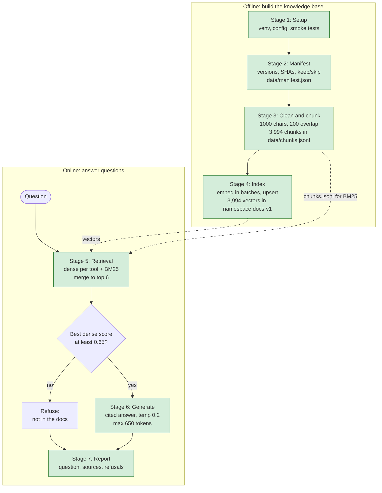

# RAG pipeline stages



Legend: green = done, yellow = next, white = not started.
Stage 6 is the only stage that calls the chat model. Stages 5 and 6 are wired together as a LangGraph graph.

# Architecture

Which script, file and service does what, and how data moves between them.

```mermaid
flowchart LR
    subgraph INPUTS["Inputs (read-only or config)"]
        CORPUS[("Corpus<br/>Airflow docs .rst<br/>Spark docs .md")]
        CFG["config.yaml<br/>all tunable values"]
        ENV[".env<br/>API keys, git-ignored"]
    end

    subgraph BUILD["Offline build: week2-rag scripts"]
        M["2_build_manifest.py<br/>versions, SHAs, keep/skip"]
        C["3a_build_chunks.py<br/>clean, split at headings,<br/>1000 chars / 200 overlap"]
        I["4a_index_chunks.py<br/>embed + upsert<br/>dry run by default"]
    end

    subgraph DATA["Generated files in data/ (git-ignored)"]
        MAN[/"manifest.json"/]
        CH[/"chunks.jsonl<br/>3,994 chunks"/]
    end

    EMB["bge-small-en-v1.5<br/>local embedder, 384 dims<br/>no key, no cost"]

    subgraph PC["Pinecone serverless"]
        VEC[("airflow-spark-rag<br/>namespace docs-v1<br/>3,994 vectors + text metadata<br/>cosine")]
    end

    subgraph QUERY["Online query"]
        R["5a_retrieval.py<br/>dense per tool + BM25<br/>rank fusion, top 6<br/>threshold 0.65"]
        G["6a_rag_graph.py (Stage 6)<br/>LangGraph: retrieve, then<br/>refuse or generate cited answer"]
        REP["7a_build_report.py (Stage 7)<br/>one card per question<br/>no model calls"]
    end

    LLM["Nebius chat<br/>Qwen3-235B-A22B-Instruct<br/>temp 0.2, max 650 tokens"]
    RUN["6b_run_questions.py<br/>runs the 20 test questions<br/>and times each one"]
    RES[/"run_results.json<br/>answers, sources, timings"/]
    OUT[/"report.html<br/>for the hand check"/]

    CORPUS --> M --> MAN
    CORPUS --> C
    MAN --> C --> CH
    CH --> I
    I --> EMB
    EMB --> I
    I -- upsert --> VEC

    Q(["Question"]) --> R
    R -- embed question with prefix --> EMB
    R -- dense search + tool filter --> VEC
    CH -- BM25 index in memory --> R
    R -- top 6 chunks + relevant flag --> G
    G -- prompt with context --> LLM
    LLM -- cited answer --> G
    RUN -- each test question --> Q
    G -- answer, sources, issues --> RUN
    RUN -- saves --> RES
    RES -- read by --> REP
    REP -- writes --> OUT

    CFG -. settings .-> BUILD
    CFG -. settings .-> QUERY
    ENV -. keys .-> I
    ENV -. keys .-> R
    ENV -. keys .-> G

    classDef done fill:#d4edda,stroke:#2e7d32;
    classDef planned fill:#fff3cd,stroke:#b8860b,stroke-dasharray: 4 3;
    class M,C,I,R,EMB,VEC,MAN,CH,G,LLM,RUN,RES,REP,OUT done;
    ```

Notes:
- Solid green = built and checked. Stage 6 calls the Nebius chat model only for questions that pass the threshold; a threshold refusal never reaches it. The last step, checking the report's answers against the chunks, is done by a person.
- The local embedder is used twice: by `4a_index_chunks.py` for the chunks (no prefix) and by `5a_retrieval.py` for the question (with the bge query prefix). Both must use the same model.
- `chunks.jsonl` is used twice as well: it is what gets indexed, and it is the in-memory BM25 index at query time.
- Only the Pinecone upsert in `4a_index_chunks.py --write` writes to a paid service. Everything else reads, or runs locally.
